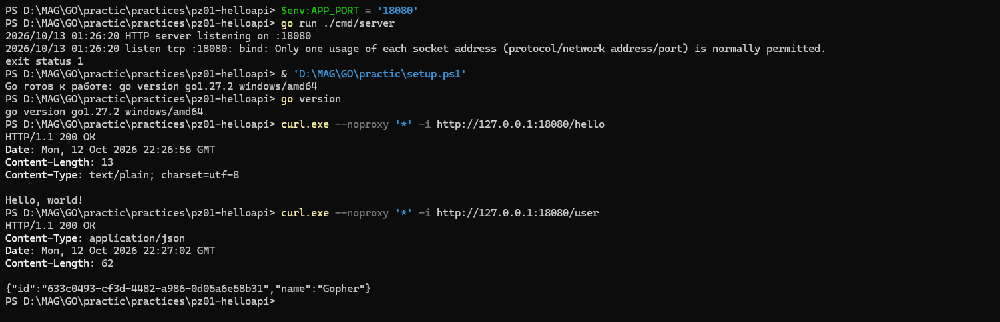
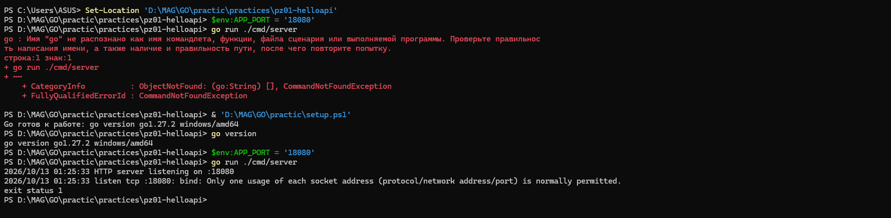

# Практическое занятие №1 — минимальный HTTP-сервис на Go

## Тема и цель

Подготовить окружение Go, создать отдельный Go-модуль и реализовать минимальный HTTP API на стандартной библиотеке `net/http` с генерацией UUID.

## Окружение

- Windows, `windows/amd64`.
- Go: `go version go1.27.2 windows/amd64`.
- Git: `git version 2.46.0.windows.1`.
- Зависимость: `github.com/google/uuid v1.6.0`.
- Для этой машины Go подключался командой `& 'D:\MAG\GO\practic\setup.ps1'` в новом PowerShell 7.6.5.

## Выполненная работа

Создан модуль `practices/pz01-helloapi` с отдельными `go.mod` и `go.sum`, точкой входа `cmd/server/main.go` и инструкцией `README.md`. Маршрут `GET /hello` возвращает `200 OK` и `Hello, world!`. `GET /user` возвращает JSON с `name: Gopher` и новым UUID v4. Реализована настройка порта через `APP_PORT`; значение по умолчанию — `8080`.

## Проверка

В каталоге модуля выполнены:

```powershell
go fmt ./...
go vet ./...
go build -o .\bin\helloapi.exe .\cmd\server
```

Все три команды завершились без ошибок. Запуск проверен и через `go run ./cmd/server`, и через собранный `helloapi.exe`. На этой машине порт `8080` занят внешним процессом `httpd`, поэтому проверки обоих вариантов выполнены на свободном порту `18080` с `APP_PORT=18080`.

Фактический ответ `curl.exe --noproxy '*' -i http://127.0.0.1:18080/hello`:

```http
HTTP/1.1 200 OK
Content-Length: 13
Content-Type: text/plain; charset=utf-8

Hello, world!
```

Фактический ответ первого запроса `curl.exe --noproxy '*' -i http://127.0.0.1:18080/user` при запуске через `go run`:

```http
HTTP/1.1 200 OK
Content-Type: application/json
Content-Length: 62

{"id":"48d86967-211d-4fe7-90c7-4a7675ef7559","name":"Gopher"}
```

Второй ответ `GET /user`:

```json
{"id":"fda1e832-7e97-4900-9d26-c81c0b13750e","name":"Gopher"}
```

Оба ответа имели статус 200 и `Content-Type: application/json`. UUID `48d86967-211d-4fe7-90c7-4a7675ef7559` и `fda1e832-7e97-4900-9d26-c81c0b13750e` соответствуют формату UUID v4 и различаются. После запуска собранного `.exe` повторно проверены оба маршрута: `/hello` вернул `200 OK` и `Hello, world!`; `/user` вернул `200 OK`, `Content-Type: application/json` и `{"id":"0ec5f827-7b9f-4cf4-9e42-8a0d24f0c243","name":"Gopher"}`.

## Скриншоты

На первом снимке видны вывод `go version` и фактические ответы `curl.exe` для `/hello` и `/user` со статусом 200. Вверху снимка также видна неудачная попытка повторно запустить сервер: порт `18080` уже был занят. Снимок подтверждает ответы по указанному адресу, но сам по себе не устанавливает, какой процесс обслуживал запросы.



Второй снимок фиксирует ошибку повторного запуска после настройки окружения.



## Проблемы и решения

1. Windows PowerShell 5.1 не смог прочитать локальный UTF-8 `setup.ps1` без BOM. Сначала запуск выполнили в PowerShell 7.6.5; позднее локальный скрипт сохранили с BOM и проверили в Windows PowerShell 5.1. Скрипт не входит в коммит.
2. Исходная попытка загрузить `github.com/google/uuid` из обычного sandbox была остановлена ограничением сети. После разрешённого запуска Go загрузил зависимость, а `go mod tidy` создал `go.sum`.
3. Порт `8080` уже занят внешним `httpd`: первые обращения к нему дали Apache `404`, это не ответы приложения. Для проверки добавлена опциональная переменная `APP_PORT`; запуск и запросы выполнены на `18080`. Посторонний `httpd` не останавливался.
4. При подготовке скриншотов повторный `go run` на `18080` завершился ошибкой `bind`: порт уже слушал другой процесс. Запросы `curl.exe` получили успешные ответы, но приложенные снимки не доказывают, что на них отвечал именно вновь запущенный процесс. Ранее выполненные проверки исходников и `.exe` описаны выше; для отдельного визуального подтверждения запуска нужен свободный порт.

## Вывод

Отдельный модуль Go реализован, отформатирован, прошёл `go vet` и сборку. Запуск из исходников и из `.exe` проверен ранее; получены ответы обоих маршрутов, проверены статусы, JSON-заголовок, имена и уникальные UUID v4. Настоящие скриншоты версии Go и ответов приложены; при их создании повторный запуск сервера не удался из-за занятого порта.

## Код

Репозиторий: [Pondaaaaaa/GO — практическое занятие №1](https://github.com/Pondaaaaaa/GO/tree/main/practices/pz01-helloapi).

Отчёт в репозитории: [reports/pz01.md](https://github.com/Pondaaaaaa/GO/blob/main/reports/pz01.md).
