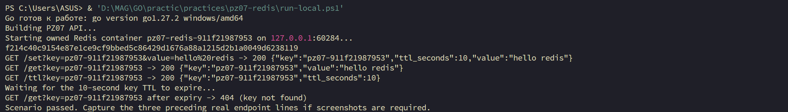

# Практическое занятие №7 — Redis: SET, GET, TTL

## Цель

Реализовать небольшой HTTP-интерфейс к Redis на Go и изучить срок жизни ключа (TTL). Redis хранит данные в структурах данных в памяти и может использоваться как кэш; в этой работе он не заменяет PostgreSQL или иную основную базу.

## Окружение

- Windows `windows/amd64`; Go `go1.27.2` (сообщение локального `setup.ps1`).
- Docker CLI `29.8.2`. Docker Engine из среды выполнения недоступен: `docker info --format '{{.ServerVersion}}'` завершился сообщением `permission denied while trying to connect to the Docker API at npipe:////./pipe/dockerDesktopLinuxEngine`.
- Реальный сценарий выполнен локально с образом `redis:7-alpine`; конкретный patch-вариант Redis на снимке не отображён.

## Реализация

В `practices/pz07-redis/` создан независимый модуль `github.com/Pondaaaaaa/GO/practices/pz07-redis`. `internal/cache/cache.go` оборачивает `go-redis/v9`, ограничивает каждую операцию таймаутом, нормализует `redis.Nil` в `ErrKeyNotFound` и закрывает клиент через `Close`. `cmd/server/main.go` использует стандартный `net/http`.

| Маршрут | Поведение |
| --- | --- |
| `GET /set?key=...&value=...` | Сохраняет строковое значение с TTL 10 секунд, отвечает JSON и 200. |
| `GET /get?key=...` | Возвращает JSON с ключом и значением; отсутствующий ключ — 404. |
| `GET /ttl?key=...` | Возвращает остаток TTL в секундах; отсутствующий ключ — 404. |

Пустые обязательные параметры дают 400; недоступность Redis — 503, а не 404. Адрес Redis задаёт `REDIS_ADDR` (по умолчанию `127.0.0.1:6379`), HTTP-порт — `PORT` (по умолчанию `8080`).

`run-local.ps1` поднимает уникальный временный контейнер `redis:7-alpine` на свободном loopback-порту и собранный API на другом, проверяет `/set`, `/get`, `/ttl` и истечение ключа, затем удаляет только созданные им ресурсы. Пароли и PostgreSQL не используются.

## Проверки

После `go mod tidy` (успешно; загружены `go-redis/v9` и `miniredis`) проверки завершились успешно:

```text
go fmt ./...   — завершилась без изменений и ошибок.
go vet ./...   — завершилась без предупреждений.
go test ./...  — cmd/server: no test files; internal/cache: ok (0.572s).
go build ./... — завершилась без ошибок.
```

Тест `internal/cache` прошёл на `miniredis`: проверены Ping, SET/GET, положительный TTL, истечение, а также отсутствие ключа после истечения. В обычном sandbox локальный TCP-тест был запрещён политикой сокетов; повторный запуск с разрешённым loopback-доступом прошёл успешно. Проверка PowerShell Parser для `run-local.ps1` также завершилась: `PowerShell parser: OK`.

Реальный сценарий `run-local.ps1` выполнен на Windows. По фактическому выводу:

```powershell
GET /set?key=pz07-911f21987953&value=hello%20redis -> 200 {"key":"pz07-911f21987953","ttl_seconds":10,"value":"hello redis"}
GET /get?key=pz07-911f21987953 -> 200 {"key":"pz07-911f21987953","value":"hello redis"}
GET /ttl?key=pz07-911f21987953 -> 200 {"key":"pz07-911f21987953","ttl_seconds":10}
GET /get?key=pz07-911f21987953 after expiry -> 404 (key not found)
Scenario passed.
```

На одном настоящем снимке видны ответы трёх маршрутов, успешное истечение ключа и завершение сценария; он включён в репозиторий:



## Контрольные вопросы

1. **Чем Redis отличается от реляционной БД?** Redis ориентирован на доступ к данным в памяти и структуры данных «ключ–значение»; реляционные БД организуют данные в таблицах и поддерживают SQL, связи и транзакции. Redis часто дополняет основную БД кэшем.
2. **Какие типы Redis поддерживает кроме строк?** Списки, множества, сортированные множества, хэши, потоки (Streams), битовые поля и HyperLogLog; набор команд зависит от версии.
3. **Для чего нужен TTL?** Автоматически удалять временные данные: например, записи кэша, одноразовые коды подтверждения и временные сессии. Это ограничивает срок хранения ключа.
4. **Как кэш может уменьшить нагрузку на PostgreSQL?** Сначала читать часто запрашиваемый результат из кэша, обращаться к PostgreSQL при промахе и сохранять результат с ограниченным TTL. Это сокращает повторные чтения при подходящем профиле запросов и корректной инвалидации; ускорение в этой работе не измерялось.
5. **Что происходит после TTL?** Redis удаляет просроченный ключ (при обращении или фоновой очистке); последующее чтение возвращает отсутствие ключа. API отображает это как 404.

## Проблемы и вывод

Первоначальный `go mod tidy` без сетевого разрешения не смог разрешить `proxy.golang.org`; повторный запуск с сетевым разрешением загрузил публичные модули. Docker Engine был недоступен из среды Codex, поэтому сценарий выполнил пользователь при запущенном Docker Desktop и предоставил настоящий снимок. Конкретная версия Redis внутри тега `redis:7-alpine` в выводе не зафиксирована.

Код практики: [каталог pz07-redis](../practices/pz07-redis/). Репозиторий: [Pondaaaaaa/GO](https://github.com/Pondaaaaaa/GO).
