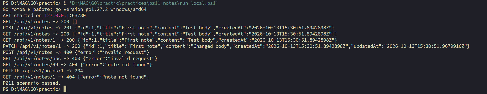

# Практическое занятие №11 — REST API заметок

**ФИО:** ____________________

**Группа:** ____________________

## Цель и задание

Спроектировать версионированный REST API для заметок с полным CRUD, разделить HTTP-обработчики, бизнес-логику и хранение, описать контракт OpenAPI. Эта практика создаёт самостоятельную основу для следующих занятий с базой данных и аутентификацией.

REST (Representational State Transfer) рассматривает заметку как ресурс `/api/v1/notes/{id}`. Операции CRUD сопоставлены методам HTTP: POST создаёт (`201`), GET читает (`200`), PATCH частично меняет (`200`), DELETE удаляет (`204` без тела). Неверный запрос получает `400`, отсутствующий ресурс — `404`. JSON используется для тел запросов и ответов, кроме успешного DELETE. Каждый запрос содержит данные, необходимые для его обработки; сервер не хранит состояние клиентской сессии.

## Структура проекта

```text
practices/pz11-notes/
  cmd/api/main.go
  internal/core/note.go
  internal/core/service/note_service.go
  internal/http/router.go
  internal/http/handlers/notes.go
  internal/http/router_test.go
  internal/repo/note_mem.go
  api/openapi.yaml
  requests/create.json
  requests/patch.json
  run-local.ps1
  README.md
  go.mod
```

`main.go` связывает слои и слушает loopback-адрес на порту из `PORT` (по умолчанию 8080):

```go
h := &handlers.Handler{Notes: service.NewNoteService(repo.NewNoteRepoMem())}
srv := &http.Server{Addr: "127.0.0.1:" + port, Handler: httpx.NewRouter(h), ReadHeaderTimeout: 5 * time.Second}
log.Fatal(srv.ListenAndServe())
```

В `note_mem.go` записи защищены `sync.RWMutex`. Создание выдаёт следующий ID и сохраняет значение заметки; список сортируется по ID:

```go
r.mu.Lock()
defer r.mu.Unlock()
r.next++
n.ID = r.next
r.notes[n.ID] = n
```

В `handlers/notes.go` удаление переводит ошибку репозитория в HTTP-ответ и возвращает `204` без тела:

```go
if err := h.Notes.Delete(noteID); err != nil {
    serverError(w, err)
    return
}
w.WriteHeader(http.StatusNoContent)
```

Полные файлы: [main.go](../practices/pz11-notes/cmd/api/main.go), [note_mem.go](../practices/pz11-notes/internal/repo/note_mem.go), [notes.go](../practices/pz11-notes/internal/http/handlers/notes.go), [OpenAPI](../practices/pz11-notes/api/openapi.yaml). Создание возвращает `Location` и `201`. Сервис проверяет непустой заголовок, репозиторий хранит данные в памяти и возвращает `ErrNotFound`. PATCH меняет только указанные поля и ставит `updatedAt`; после перезапуска заметки исчезают.

## Запуск и проверки

Окружение: Windows `windows/amd64`, Go `go1.27.2`, Windows PowerShell 5.1, `chi v5.4.0`. База данных и Docker не требуются. Одна команда из любого каталога:

```powershell
& 'D:\MAG\GO\practic\practices\pz11-notes\run-local.ps1'
```

Скрипт собирает приложение, выбирает свободный порт, отправляет реальные HTTP-запросы через `curl.exe`, сверяет коды и тело ответа `204`, останавливает только свой сервер. Для ручного запуска и curl-команд есть [README](../practices/pz11-notes/README.md). JSON для curl передаётся из файлов `requests/*.json`, что одинаково работает в Windows PowerShell 5.1 и новых версиях PowerShell.

Успешно выполнены `go fmt ./...`, `go vet ./...`, `go test ./...`, `go build ./...`, `go mod verify`. Модульные HTTP-тесты проверяют все CRUD-маршруты, ошибки ввода, неизвестные ID, пустое тело DELETE и одновременное создание 20 заметок.

Реальный сценарий завершился `PZ11 scenario passed.`. Полный [вывод curl](logs/pz11-http.txt) сохранён без персональных данных. Основные результаты:

| Запрос | Код | Результат |
| --- | --- | --- |
| GET `/api/v1/notes` до создания | 200 | `[]` |
| POST `/api/v1/notes` | 201 | `id=1`, `title=First note` |
| GET списка и GET `/1` | 200 | Созданная заметка |
| PATCH `/1` | 200 | `content=Changed body`, появился `updatedAt` |
| POST с пустым title | 400 | JSON ошибки |
| GET с неверным ID | 400 | JSON ошибки |
| GET отсутствующего ID | 404 | JSON ошибки |
| DELETE `/1` | 204 | Тело пустое |
| GET `/1` после удаления | 404 | Заметка отсутствует |

Настоящий снимок локального прогона пользователя подтверждает эти ответы:



При первой попытке на Windows PowerShell JSON-аргумент `curl.exe -d` передался иначе, и POST вернул 400. Скрипт исправлен: JSON записывается во временный UTF-8 файл без BOM и передаётся через `--data-binary @файл`. Повторный запуск в Windows PowerShell 5.1 и на машине пользователя дал `201` и прошёл весь сценарий.

## Контрольные вопросы

1. **Что означает REST?** Representational State Transfer — архитектурный стиль, где клиент работает с ресурсами через единообразный HTTP-интерфейс и передаёт представления ресурсов, например JSON.
2. **Как CRUD связан с HTTP?** Create — POST, Read — GET, Update — PATCH/PUT, Delete — DELETE. Метод выражает операцию, а путь указывает ресурс.
3. **Зачем разделять handler, service и repository?** Handler отвечает за HTTP и JSON, service — за правила работы с заметками, repository — за хранение. Это позволяет менять способ хранения без переписывания HTTP-контракта и тестировать слои отдельно.
4. **Что значит stateless?** Сервер не обязан помнить состояние клиентского диалога между запросами; каждый запрос содержит необходимую информацию. Сами заметки при этом могут храниться на сервере.
5. **Зачем стандартные HTTP-коды?** Они позволяют клиенту различать успех, ошибку ввода, отсутствие ресурса и сбой сервера без разбора текста тела. `204` прямо сообщает, что успешного тела нет.
6. **Как добавить аутентификацию?** Перед защищёнными маршрутами ставят middleware, которое проверяет Bearer JWT или серверную сессию, помещает сведения пользователя в контекст и затем проверяет его права. Текущий №11 оставлен без аутентификации по заданию.
7. **Зачем версия `/api/v1/`?** Она позволяет вводить несовместимые изменения в `/api/v2/`, сохраняя прежний контракт для клиентов первой версии.

## Вывод

Самостоятельный Notes API реализует все пять CRUD-операций и разделение handler → service → repository. OpenAPI описывает маршруты и схемы. Код, тесты, реальный curl-прогон и скриншот подтверждают работу без базы данных; хранение пока ограничено памятью процесса. [Репозиторий](https://github.com/Pondaaaaaa/GO) и [код практики](../practices/pz11-notes/).
