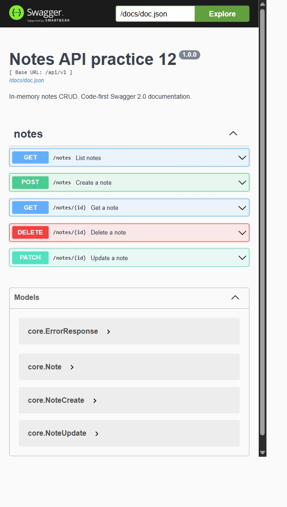

# Практическое занятие 12 Документация Notes API

## Цель и выбранный подход

Подготовлена документация работающего CRUD API заметок методом code-first: комментарии Go → swag → пакет docs и Swagger UI. Практика выполнена как самостоятельный модуль `practices/pz12-notes`; исходный модуль №11 не изменён. Пять операций, JSON-модели и ошибки проверены тестами и реальными HTTP-запросами. Получен настоящий снимок Swagger UI.

Генератор swag создаёт **Swagger 2.0**. Ручная спецификация `practices/pz11-notes/api/openapi.yaml` имеет формат **OpenAPI 3.0.3** и остаётся в №11. Она не копируется в №12 и не синхронизируется автоматически с результатом генерации. У Swagger 2.0 здесь используются `definitions`, `basePath` и body parameters; у OpenAPI 3.0 — `components.schemas`, `servers` и `requestBody`.

## Окружение и структура

Проверено 13 октября 2026 года на Windows amd64: Go `go1.27.2`, PowerShell `7.6.5` и Windows PowerShell `5.1.26100.9549`, curl `8.21.0`. Зависимости: chi `v5.4.0`, swag `v1.16.6`, http-swagger/v2 `v2.0.2`. Установленный из модуля swag v1.16.6 бинарник сообщает `swag.exe version v1.16.4`; фактическую версию модуля подтверждает `go version -m`: `github.com/swaggo/swag v1.16.6`. Поэтому скрипт проверяет метаданные Go, а не эту строку CLI.

```text
practices/pz12-notes/
  cmd/api/main.go
  internal/core/note.go
  internal/core/service/note_service.go
  internal/repo/note_mem.go
  internal/http/router.go
  internal/http/router_test.go
  internal/http/handlers/notes.go
  docs/docs.go
  docs/swagger.json
  docs/swagger.yaml
  requests/create.json
  requests/patch.json
  generate-docs.ps1
  run-local.ps1
  README.md
  go.mod, go.sum
```

`Note` описывает ответ с id, title, content, createdAt и необязательным updatedAt. `NoteCreate` принимает title и content. `NoteUpdate` использует указатели, чтобы различать пропущенное поле и пустой content. Ошибки имеют общую модель `ErrorResponse`. Репозиторий хранит заметки в памяти под mutex; сервис проверяет title и обновляет время; handler занимается HTTP. Данные исчезают при остановке процесса.

## Аннотации и генерация

Общие аннотации в `cmd/api/main.go`: `@title Notes API practice 12`, `@version 1.0.0`, `@description` и `@BasePath /api/v1`. Импорт с побочным эффектом подключает сгенерированный пакет docs. В chi маршрут `/docs/*` передаётся http-swagger, URL спецификации — `/docs/doc.json`. Фиксированный host отсутствует, поэтому UI использует текущий адрес сервера и свободный порт.

Фрагменты реальных аннотаций трёх методов из [handlers/notes.go](../practices/pz12-notes/internal/http/handlers/notes.go):

```go
// @Summary Create a note
// @Accept json
// @Produce json
// @Param note body core.NoteCreate true "New note"
// @Success 201 {object} core.Note
// @Header 201 {string} Location "Relative URL of the created note"
// @Failure 400 {object} core.ErrorResponse "Invalid JSON, content type or title"
// @Failure 500 {object} core.ErrorResponse "Repository error"
// @Router /notes [post]
```

```go
// @Summary List notes
// @Description All notes ordered by ascending ID; an empty repository returns []. No filtering or pagination.
// @Success 200 {array} core.Note
// @Failure 500 {object} core.ErrorResponse "Repository error"
// @Router /notes [get]
```

```go
// @Summary Delete a note
// @Param id path int true "Positive note ID" minimum(1)
// @Success 204 "Deleted without response body"
// @Failure 400 {object} core.ErrorResponse "Invalid ID"
// @Failure 404 {object} core.ErrorResponse "Note not found"
// @Failure 500 {object} core.ErrorResponse "Repository error"
// @Router /notes/{id} [delete]
```

Остальные два метода — GetNote и UpdateNote — также аннотированы. В списке нет вымышленных page/limit/q или X-Total-Count. Контакт университета не добавлялся. У ответа DELETE 204 нет схемы тела. Ограничения PATCH (хотя бы одно ненулевое поле, непустой title) и запрет неизвестных полей описаны текстом, поскольку выбранный генератор не выражает все эти правила машинной схемой Swagger 2.0.

Выполненная команда из любого каталога:

```powershell
& 'D:\MAG\GO\practic\practices\pz12-notes\generate-docs.ps1'
```

Скрипт устанавливает `github.com/swaggo/swag/cmd/swag@v1.16.6` при отсутствии проверенного локального бинарника и запускает из корня модуля:

```powershell
swag init --dir ./cmd/api,./internal/core,./internal/http --generalInfo main.go --parseInternal --output ./docs
```

Сгенерированные файлы вручную не правились. Два последовательных запуска дали одинаковые SHA256 для docs.go, swagger.json и swagger.yaml. Генерация также успешно выполнена в Windows PowerShell 5.1.

## Проверки и фактические ответы

`go fmt ./...`, `go vet ./...`, `go test ./...`, `go build ./...`, `go mod verify` завершились успешно; последняя команда вывела `all modules verified`. [Полный вывод проверок](logs/pz12-checks.txt). Тесты проверяют CRUD, параллельное создание, неверные запросы, ограничение размера, тип содержимого, доступность UI и соответствие спецификации пяти операциям и кодам. Ошибки 500 проверены отдельно через репозиторий, возвращающий ошибку; HTTP-ответ содержит общий текст без внутренних подробностей. Реальная память в обычном сценарии ошибки 500 не вызывала.

Одна команда автоматического сценария:

```powershell
& 'D:\MAG\GO\practic\practices\pz12-notes\run-local.ps1'
```

Прогон Windows PowerShell 5.1 из `D:\MAG\GO` выбрал порт 49797 и завершился `PZ12 scenario passed.`. [Подлинный лог](logs/pz12-http.txt):

| Запрос | Ожидалось | Получено |
| --- | --- | --- |
| POST /api/v1/notes | 201 Note и Location | 201 Note |
| GET /api/v1/notes | 200 массив | 200 массив из одной заметки |
| GET /api/v1/notes/1 | 200 Note | 200 Note |
| PATCH /api/v1/notes/1 | 200 Note с updatedAt | 200, content изменён, updatedAt заполнен |
| DELETE /api/v1/notes/1 | 204, 0 байт тела | 204, 0 байт |
| POST с пустым title | 400 JSON | 400 invalid request |
| GET /api/v1/notes/abc | 400 JSON | 400 invalid request |
| GET /api/v1/notes/99 | 404 JSON | 404 note not found |
| GET после удаления | 404 JSON | 404 note not found |
| GET /docs/index.html | 200 UI | 200, HTML со SwaggerUIBundle |
| GET /docs/doc.json | 200 Swagger 2.0 | 200, basePath /api/v1, пять операций |

Location подтверждён HTTP-тестом; JSON Content-Type проверялся в реальном сценарии для всех непустых ответов. Пример настоящего POST-ответа:

```json
{"id":1,"title":"First note","content":"Test body","createdAt":"2026-10-13T16:00:52.69289Z"}
```

После PATCH получен `content: "Changed body"` и `updatedAt: "2026-10-13T16:00:52.838467Z"`. Тело DELETE было пустым. Страница UI работала на свободном порту 63830 в режиме KeepOpen. Через Try it out → Execute выполнен GET `http://127.0.0.1:63830/api/v1/notes`, получены 200, `[]` и `application/json; charset=utf-8`. После Enter скрипт завершил свой сервер; на портах завершённых прогонов не осталось слушателей.

## Настоящий снимок Swagger UI

Изображение получено захватом открытой страницы браузера, без имитации. Видны название, Base URL, все пять операций и модели.



Для повторного снимка:

```powershell
& 'D:\MAG\GO\practic\practices\pz12-notes\run-local.ps1' -KeepOpen
```

Откройте напечатанный URL `/docs/index.html`, снимите окно браузера, затем нажмите Enter в терминале для очистки. Точные ручные команды curl с файлами JSON приведены в [README](../practices/pz12-notes/README.md).

## Проблемы и решения

При первичной генерации swag предупреждал об отсутствии Go-файлов в корне internal. Список каталогов уточнён до cmd/api, internal/core и internal/http; предупреждение исчезло. Песочница ограничивала доступ к Go proxy и loopback, поэтому загрузка зависимостей и реальные сценарии проведены в разрешённом обычном окружении. Правила выполнения PowerShell не отключались.

При подготовке №12 обнаружено принятие Content-Type application/jsonx и возможность отсечь лишнее содержимое лимитированным reader. В новом модуле используются mime.ParseMediaType и явная проверка фактического размера до декодирования; новые тесты проходят. Ошибка передачи массива аргументов curl при переименовании переменной исправлена до окончательного прогона Windows PowerShell 5.1. Модуль №11 сохранился без изменений.

## Контрольные вопросы

1. **Чем отличается OpenAPI от Swagger?** OpenAPI — спецификация описания HTTP API. Swagger — семейство инструментов, включая Swagger UI, и историческое название формата 2.0. В этой работе swag генерирует Swagger 2.0; исходный контракт №11 использует OpenAPI 3.0.3.
2. **Code-first и schema-first, плюсы и минусы.** При code-first описание строится из кода и аннотаций: удобно поддерживать рядом с обработчиками, но комментарии могут устареть и генератор ограничивает выразительность. При schema-first сначала создают контракт и генерируют серверные интерфейсы или клиент: проще согласовать API до реализации, но нужно поддерживать процесс генерации и соответствие кода контракту.
3. **Обязательные разделы OpenAPI.** Для OpenAPI 3.0.3 на верхнем уровне обязательны openapi, info и paths; info содержит title и version. Операция содержит responses, каждый ответ — description. servers, components и tags полезны, но не обязательны во всех документах. Для Swagger 2.0 корневой номер формата задаётся swagger.
4. **Зачем components.schemas и как использовать в responses?** Это переиспользуемые модели OpenAPI 3.0. Ответ ссылается на них через content → application/json → schema → $ref: '#/components/schemas/Note'. Так модель определяют один раз. В сгенерированном Swagger 2.0 аналог расположен в definitions, ссылка имеет вид '#/definitions/core.Note', а schema находится непосредственно в response.
5. **Что описывают @Param, @Success, @Failure, @Router, @Security?** @Param задаёт параметр, его расположение, тип и обязательность; @Success и @Failure — HTTP-коды и модели ответов; @Router — путь и метод; @Security — требуемую схему защиты. Эти комментарии документируют поведение, но не создают маршруты, валидацию или проверку токена сами.
6. **Как опубликовать UI на /docs и ограничить доступ?** В chi регистрируют `/docs/*` с http-swagger и URL спецификации. Для закрытого доступа весь префикс, включая JSON и ресурсы UI, помещают под middleware аутентификации и авторизации либо ограничивают на прокси. В этой учебной работе сервер слушает loopback, отдельная аутентификация UI не добавлена.
7. **Как поддерживать актуальность документации?** Менять аннотации и DTO вместе с обработчиками, запускать закреплённый генератор, просматривать diff сгенерированных файлов и проверять HTTP-контракт тестами. В CI можно повторять генерацию и требовать пустой git diff. В этой работе проверены повторная генерация и контракт пяти операций; CI не настраивался.
8. **Как добавить Bearer и что изменится в UI?** В OpenAPI 3.0 задают components.securitySchemes с type: http, scheme: bearer и при необходимости bearerFormat: JWT, затем security на операциях. Для Swagger 2.0 обычно описывают apiKey в заголовке Authorization и @Security; вводят строку Bearer с токеном целиком. UI показывает Authorize и отправляет заголовок в защищённых запросах. Сервер обязан независимо проверять токен. В №12 Bearer не реализован, поскольку CRUD публичный.

## Вывод

Все обязательные пункты №12 выполнены: самостоятельный модуль, пять точных аннотаций, модели, воспроизводимая генерация Swagger 2.0, открытая UI, автоматический реальный сценарий, настоящий снимок и оба формата отчёта. Бонусы Bearer, ReDoc и отдельный линтер не выполнялись. [Код](../practices/pz12-notes/), [документация генератора](https://github.com/swaggo/swag), [http-swagger](https://github.com/swaggo/http-swagger).
