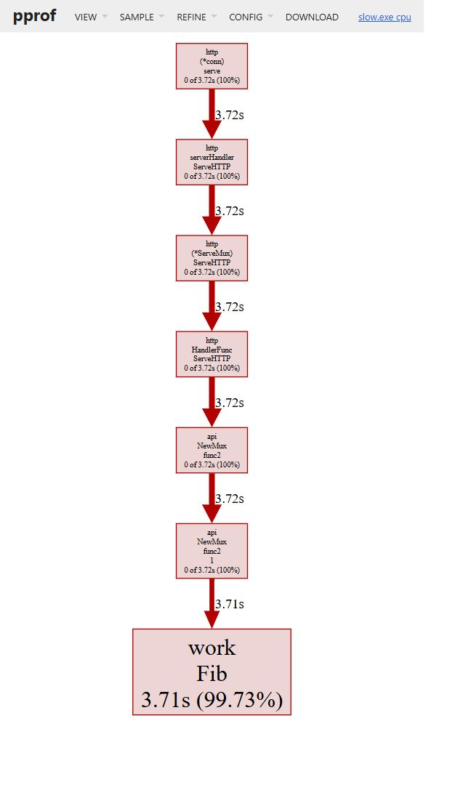

# Практическое занятие 13 Профилирование Go приложения

## Цель и результат

Создан самостоятельный стенд для поиска CPU-узкого места и проверки оптимизации. Рекурсивный Fib заменён в HTTP-обработчике на итеративный FibFast. Реальные CPU-профили, top/list, граф, Heap, таймеры и три прогона бенчмарков подтверждают сокращение времени вычисления. Аллокации обеих функций остаются нулевыми; улучшение удерживаемой Heap-памяти не обнаружено. Практики №11 и №12 не изменялись.

## Структура и окружение

```text
practices/pz13-pprof/
  cmd/api/main.go         выбор режима и параметров
  cmd/api/listen.go       loopback listener
  cmd/load/main.go        ограниченная нагрузка
  internal/api/api.go     /work, pprof и учебный Heap
  internal/api/api_test.go
  internal/work/fib.go    Fib и FibFast
  internal/work/timer.go  TimeIt
  internal/work/fib_test.go
  run-local.ps1
  README.md
  go.mod
```

Проверено 13 октября 2026 года на Windows amd64: Go `go1.27.2`, PowerShell `7.6.5`, Windows PowerShell `5.1.26100.9549`, curl `8.21.0`; процессор Intel Core i9-14900KF. Внешних Go-зависимостей нет. Graphviz в PATH отсутствовал; официальная переносная сборка `16.1.0 (20260904.0139)` загружена в локальный каталог вне Git. SHA256 архива совпал с опубликованным контрольным файлом на [странице Graphviz](https://graphviz.org/download/).

Сервер использует собственный ServeMux. Обработчики pprof подключены явно, потому что импорт net/http/pprof регистрирует маршруты только в DefaultServeMux. Импорт fmt присутствует. Listener создаётся на `127.0.0.1:0`, ОС выбирает свободный порт. Сервер и pprof UI не слушают внешние интерфейсы.

## Воспроизведение и условия замера

Основная команда из любого каталога:

```powershell
& 'D:\MAG\GO\practic\practices\pz13-pprof\run-local.ps1'
```

Фактически выполнен расширенный вариант из `D:\MAG\GO` в Windows PowerShell 5.1:

```powershell
& 'D:\MAG\GO\practic\practices\pz13-pprof\run-local.ps1' -OpenUI -OutputDirectory 'D:\MAG\GO\.local\pz13-evidence'
```

Скрипт устанавливает GOMAXPROCS=1 и сохраняет прежнее значение. Сначала собирает slow.exe с `go build -ldflags '-X main.defaultMode=slow'`, измеряет его, затем собирает fast.exe с теми же настройками и `main.defaultMode=fast`. Обычные символы Go сохранены: флаги -s/-w не используются, оптимизации компилятора не отключаются. Оба бинарника создаются из одного исходного кода.

Вход HTTP в обоих вариантах — **n=38**, правильный результат — **39088169**. Сначала выполняются проверочные health, work, индекс pprof и goroutine. Далее CPU-профиль снимается **12 секунд**; через 250 мс после запуска запроса профиля начинается нагрузка: **24 запроса, concurrency=1, интервал 500 мс, целевые 2 запроса/с**. Каждый ответ проверяется на 200 и ожидаемый результат. Используются один нагрузчик, одинаковые параметры, одинаковое логирование и тот же компьютер. Фактическое время нагрузки — 11,6806733 с до и 11,5009843 с после; 24-й запрос стартует через 11,5 с после первого, поэтому это не тест максимальной пропускной способности. В обоих случаях late_arrivals=0.

После CPU-профиля отдельный `/heap-work` удерживает буфер **4194304 байта**, затем снимается `/debug/pprof/heap?gc=1`. Эта аллокация выполняется одинаково в обеих версиях и не является частью Fib. До завершения измерений сервер останавливается, чтобы профили анализировались без продолжающейся нагрузки. При выходе скрипт завершает только свои процессы, восстанавливает PATH/GOMAXPROCS и удаляет свои временные exe и бинарные профили.

## Реальные HTTP маршруты и команды pprof

В окончательном прогоне серверы использовали порты **56981** и **56990**. `/work` вернул `39088169` и статус 200. `/health`, `/debug/pprof/`, `/debug/pprof/goroutine?debug=1`, `/debug/pprof/profile?seconds=12`, `/heap-work`, `/debug/pprof/heap?gc=1` были успешно вызваны. Бинарные CPU/Heap-файлы прочитаны настоящим go tool pprof. Тест дополнительно проверяет индекс и goroutine на собственном mux, результат обеих функций и учебный Heap-буфер.

Команды анализа, выполняемые скриптом с соответствующими временными именами:

```powershell
go tool pprof -top slow.exe slow-cpu.pprof
go tool pprof -list=Fib slow.exe slow-cpu.pprof
go tool pprof -svg -output slow-cpu.svg slow.exe slow-cpu.pprof
go tool pprof -sample_index=inuse_space -top slow.exe slow-heap.pprof
go tool pprof -sample_index=alloc_space -top slow.exe slow-heap.pprof
```

Для fast используются те же команды с fast.exe и fast-профилями. Генерировались настоящие SVG обеих версий через pprof и dot. SVG и бинарные профили не включены в Git; настоящий снимок графа до оптимизации приложен ниже. В публичных текстовых логах путь временной папки в синтезированном Windows Build ID заменён на `<temporary-pz13-dir>`. Числовые данные профилей не изменялись.

## CPU до оптимизации

[Полный top](logs/pz13/slow-cpu-top.txt) содержит:

```text
Duration: 12s, Total samples = 3.72s (31.00%)
flat    flat%   sum%     cum     cum%
3.71s   99.73%  99.73%   3.71s   99.73%  internal/work.Fib
```

Здесь показано сокращённое имя функции; полное имя присутствует в логе. flat — CPU непосредственно в функции, cum — вместе с вызовами. 31% — отношение общего CPU-времени сэмплов к 12 секундам наблюдения, а не «скорость Fib». Остальное время сервер ожидал очередные запросы.

В [list Fib](logs/pz13/slow-cpu-list.txt) горячая строка — два рекурсивных вызова:

```text
Total: 3.72s
3.71s  5.76s (flat, cum) 154.84% of Total
1.13s  1.13s   4:func Fib(n int) int {
220ms  220ms   5:    if n < 2 {
700ms  700ms   6:        return n
    .      .   7:    }
1.66s  3.71s   8:    return Fib(n-1) + Fib(n-2)
```

В рекурсивном list суммарные cumulative-значения строк могут учитывать вложенные кадры повторно и превышать 100%; 154,84% не означает дополнительное реальное время сверх длительности профиля. Результат top и графа указывает на многократный пересчёт одинаковых подзадач внутри Fib.

Ниже настоящий захват браузера с pprof UI на `127.0.0.1:49368/ui/graph`. Граф показывает цепочку HTTP-обработчиков до work.Fib и её 3,71 с / 99,73%. Изображение не рисовалось вручную.



Для повторного снимка выполните `run-local.ps1 -OpenUI`, откройте напечатанный URL, выберите View → Graph, затем нажмите Enter в терминале для очистки. В этом прогоне UI действительно открылась; после Enter на использованных портах не осталось слушателей.

## Изменение и CPU после оптимизации

Fib выполняет два рекурсивных вызова для каждого нетривиального n, экспоненциально повторяя вычисления. FibFast хранит два предыдущих значения и выполняет линейный цикл:

```go
a, b := 0, 1
for i := 2; i <= n; i++ {
    a, b = b, a+b
}
return b
```

Выбор функции в `/work` заменён через режим сборки; объём HTTP-нагрузки и n остались прежними. [CPU top после](logs/pz13/fast-cpu-top.txt): 12 с наблюдения, всего **10 мс сэмплов (0,083%)**. Единственный sampled hot spot — `net/textproto.validHeaderFieldByte`, а FibFast отсутствует. [list после](logs/pz13/fast-cpu-list.txt) честно сообщает `no matches found for regexp: Fib`. По столь малой выборке нельзя надёжно ранжировать быстрые функции или считать их время нулевым; основной количественный результат даёт бенчмарк.

## Heap и ручные таймеры

В [inuse_space до](logs/pz13/slow-heap-inuse_space.txt) и [после](logs/pz13/fast-heap-inuse_space.txt) показаны одинаковые **4 MiB живой памяти**, удерживаемые HeapLab.Allocate. Профиль получен после принудительного GC. Ни Fib, ни FibFast в нём не являются источниками аллокаций.

[alloc_space до](logs/pz13/slow-heap-alloc_space.txt) показывает суммарную выборочную оценку **6376,68 KiB**. Из них 4097,37 KiB относятся к учебному буферу, 1184,27 KiB к StartCPUProfile, 583,01 KiB к compress/flate.newFastEnc, 512,02 KiB к чтению HTTP-заголовков. [alloc_space после](logs/pz13/fast-heap-alloc_space.txt) — **5,16 MiB**, включая тот же буфер и StartCPUProfile. Это накопленные выделения серверного процесса вместе с самим профилировщиком и компрессией, а не память одной операции Fib. Разница этих sampled totals не доказывает снижение аллокаций алгоритма. Подтверждённый результат: удержание буфера не изменилось, бенчмарки обеих функций показывают нулевые heap-аллокации.

`TimeIt` использует time.Now/time.Since; замер охватывает только вызов функции, включая стоимость таймера, и исключает запись HTTP-тела. В [логе до](logs/pz13/slow-timers.txt) имеются реальные строки:

```text
2026/10/13 19:41:13 slow(38) took 134.9273ms
2026/10/13 19:41:16 slow(38) took 172.8655ms
2026/10/13 19:41:24 slow(38) took 180.42ms
```

В [логе после](logs/pz13/fast-timers.txt) все 25 отдельных вызовов показали `fast(38) took 0s`. Такой результат означает, что одиночное измерение оказалось ниже разрешения используемого времени в данном окружении; функция не выполняется мгновенно. Бенчмарк измеряет множество повторений и разрешает эту разницу.

[Нагрузка до](logs/pz13/slow-load.txt): mean_http=167,991 мс, max_http=181,3562 мс. [После](logs/pz13/fast-load.txt): mean_http=812,67 мкс, max_http=2,9969 мс. HTTP-время включает клиента, транспорт, логирование и ответ, поэтому не равно ns/op функции.

## Бенчмарки и проверки

Выполнено `go test -bench=. -benchmem -count=3 ./...` при GOMAXPROCS=1, без CPU-профилирования. Обе функции используют **n=30**, ожидается **832040**. Перед таймером проверяется результат, после цикла он сохраняется в глобальный Sink и проверяется ещё раз. Вход берётся из переменной. Это защищает вычисление от удаления как неиспользуемого. Измеряются непосредственно функции без HTTP и TimeIt.

Фактические строки из [полного benchmark-лога](logs/pz13/benchmarks.txt):

| Вариант | ns/op прогон 1 | ns/op прогон 2 | ns/op прогон 3 | Медиана ns/op | B/op | allocs/op |
| --- | --- | --- | --- | --- | --- | --- |
| Fib до | 3096615 | 3342112 | 3897111 | 3342112 | 0 | 0 |
| FibFast после | 11,06 | 11,27 | 11,07 | 11,07 | 0 | 0 |

Отношение медиан — примерно **301907**. Это преимущество конкретного итеративного алгоритма при n=30, а не универсальное ускорение приложения. У рекурсивных результатов заметен разброс: температура, частота CPU и фоновая работа полностью не контролировались. n=38 использовалось для наглядного HTTP CPU-профиля, n=30 — для разумной длительности бенчмарков; до/после сравниваются только при одинаковом n внутри каждого эксперимента. Аллокации не уменьшились: они были и остались нулевыми.

`go fmt ./...`, `go vet ./...`, `go test ./...`, `go build ./...` завершились успешно. [Подлинный вывод проверок](logs/pz13/checks.txt). Итоговый реальный PowerShell-сценарий завершился `PZ13 scenario passed.`; CPU/Heap были собраны, top/list проанализированы, SVG построены, UI открыта и снята, свои процессы и временные бинарные профили удалены.

## Проблемы и ограничения

Исправлены две ошибки учебного образца: отсутствующий fmt и подключение pprof к собственному ServeMux. Graphviz установлен локально из официального архива с проверкой SHA256. В Windows PowerShell 5.1 для фонового curl пришлось сохранить process.Handle до его завершения, чтобы получить ExitCode. Native stderr от ожидаемого отсутствия совпадений list обработан отдельно; другие ошибки go tool pprof приводят к остановке сценария и очистке.

CPU-сэмплов быстрого алгоритма мало; нулевые одиночные таймеры недостаточно точны. Измерения проведены на одном компьютере, но системная частота и фоновые процессы не фиксировались. Нагрузка ограничена 2 запросами/с и не измеряет предельный RPS. Heap учитывает HTTP и профилировщик, а также отдельную искусственную аллокацию; вывод об улучшении памяти не делается. Блокировки/mutex и flamegraph не исследовались — это дополнительные пункты.

## Контрольные вопросы

1. **Чем профилирование отличается от логирования и таймеров?** Логи фиксируют выбранные события, таймер — интервал конкретного участка. Профилирование собирает стеки и распределяет ресурсы между функциями, позволяя найти незапланированное узкое место. CPU и Heap основаны на выборке и вносят накладные расходы.
2. **Что показывает CPU-профиль и как читать top/list/graph?** Он связывает сэмплы процессорного времени со стеками. top показывает flat непосредственно в функции и cum вместе с дочерними вызовами; list связывает затраты со строками исходника; graph показывает связи вызовов и их вес. В этой работе Fib доминирует в CPU, а быстрый вариант ниже детализации выборки.
3. **Разница allocs и inuse в Heap?** alloc_space/alloc_objects — накопленные байты/объекты выделений, включая уже освобождённые; inuse_space/inuse_objects — оценка ещё живых байтов/объектов на момент профиля. gc=1 делает снимок после GC. Это не полный размер памяти процесса и не счётчик аллокаций одной функции.
4. **Как включить и зачем анализировать block и mutex?** runtime.SetBlockProfileRate задаёт частоту регистрации ожиданий синхронизации; runtime.SetMutexProfileFraction включает выборку конкуренции mutex. Block помогает искать время ожидания каналов и блокировок, mutex — конкуренцию критических секций. Нужно учитывать стоимость сбора и отключать его после эксперимента. В обязательном сценарии они не включались.
5. **Метрики testing.B?** ns/op — среднее время итерации, B/op — выделенные в heap байты на итерацию, allocs/op — число heap-выделений. -benchmem выводит память. ResetTimer/StopTimer исключают подготовку и проверку; одинаковый вход и наблюдаемый результат делают сравнение корректнее. Здесь обе функции имеют 0 B/op и 0 allocs/op.
6. **Почему одинаковая нагрузка и до/после важны?** Изменение n, concurrency, расписания, длительности профиля или режима сборки может объяснить разницу вместо оптимизации. Базовый замер и повтор на тех же условиях позволяют связать результат с изменением алгоритма. Несколько прогонов помогают увидеть шум, но не устраняют его полностью.
7. **Порядок поиска узкого места?** Определить проверяемую нагрузку и метрику, получить baseline, собрать подходящий профиль, найти горячий участок, сформулировать и внести минимальную оптимизацию, проверить правильность результатов, повторить измерения в тех же условиях и записать ограничения. Здесь проблема — повторные рекурсивные вычисления, решение — линейный цикл.

## Вывод

Обязательная часть выполнена: работающий loopback-сервер и pprof, реальные CPU/Heap до и после, top/list и граф до оптимизации, ручные таймеры, корректные бенчмарки, автоматизация и оба формата отчёта. Изменение алгоритма ускорило вычисление при сохранении результата; снижение аллокаций не показано. Для дальнейшего анализа быстрого варианта понадобилась бы отдельная более интенсивная нагрузка, с сохранением сопоставимых условий. [Код и команды](../practices/pz13-pprof/README.md). Документация [net/http/pprof](https://pkg.go.dev/net/http/pprof) описывает используемые HTTP-профили.
