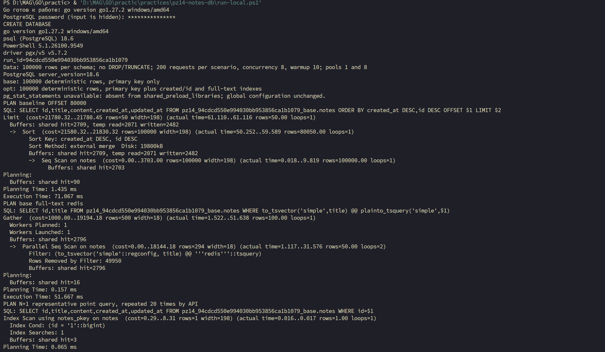
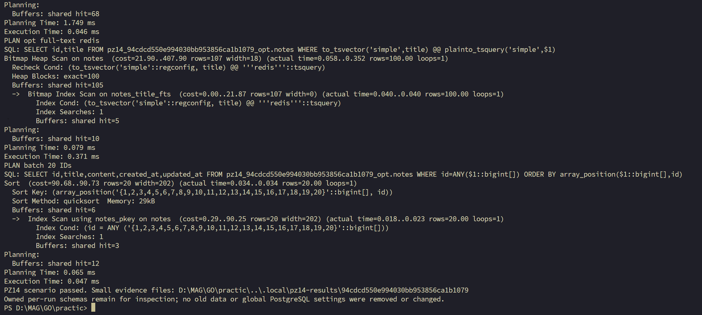

# Практическое занятие 14 Оптимизация PostgreSQL и пул соединений

## Статус и цель

**Практика выполнена и проверена на локальном PostgreSQL.** 13 октября 2026 года пользователь запустил `run-local.ps1`, ввёл пароль скрытым вводом и получил `PZ14 scenario passed.`. В этом отчёте приведены данные именно этого прогона: `run_id=94cdcd550e994030bb953856ca1b1079`. Цель — перенести Notes API в PostgreSQL, сравнить индексы и keyset с большим OFFSET, батч с N+1 и влияние размера пула. Создан отдельный модуль practices/pz14-notes-db; №11 и №12 не изменялись.

## Окружение и структура

Фактически проверены Go go1.27.2 windows/amd64, PostgreSQL-клиент и сервер 18.6, Windows PowerShell 5.1.26100.9549. Зависимости закреплены: chi v5.4.0, pgx/v5 v5.7.2. Используется database/sql с драйвером pgx/stdlib. PostgreSQL и Docker глобально не перенастраивались. [Версии](logs/pz14/versions.txt) и [подготовка данных](logs/pz14/prepare.txt) сохранены.

```text
practices/pz14-notes-db/
  cmd/api/main.go          запуск loopback API
  cmd/lab/main.go          подготовка, EXPLAIN, проверка, нагрузка
  internal/notes/repo.go   SQL, prepared statements, транзакции
  internal/notes/http.go   CRUD, пагинация, батч, DBStats
  internal/notes/notes_test.go
  run-local.ps1
  README.md
  go.mod, go.sum
```

Модель Note сохраняет id/title/content/createdAt/updatedAt. Все пять CRUD-маршрутов реализованы на chi. Добавлены batch, many и диагностический stats. Контексты HTTP ограничены 10 секундами. JSON, параметры и схема проверяются; клиент получает общий текст ошибки без строк подключения. [Реальный HTTP-лог](logs/pz14/http.txt) подтверждает POST 201, GET 200, PATCH 200, DELETE 204 с пустым телом, GET после удаления 404 и ошибки 400.

## План безопасного сравнения

Каждый запуск создаёт две новые схемы в учебной БД pz14_notes: pz14_<UUID>_base и pz14_<UUID>_opt. В проверенном прогоне каждая содержала 100000 одинаковых детерминированных строк. В baseline только первичный ключ; optimized получает индексы сортировки и полнотекстового поиска. Старые схемы не удаляются и не изменяются. Повторный запуск не использует ранее проиндексированную таблицу как baseline. Никаких DROP/TRUNCATE в коде нет; новые схемы остаются для последующей инспекции и требуют места.

Индекс `(created_at DESC,id DESC)` соответствует порядку списка и предикату keyset. GIN построен по `to_tsvector('simple',title)` и применяется только к соответствующему полнотекстовому запросу, а не к LIKE-префиксу. В учебном примере DOCX эти назначения были смешаны; здесь они разделены.

## SQL и реальные планы

В реализации baseline использует:

```sql
SELECT id,title,content,created_at,updated_at
FROM notes
ORDER BY created_at DESC,id DESC
OFFSET $1 LIMIT $2;
```

Для сравнения выбраны offset=80000, limit=50. Optimized получает ту же логическую страницу через известный курсор:

```sql
SELECT id,title,content,created_at,updated_at
FROM notes
WHERE (created_at,id)<($1,$2)
ORDER BY created_at DESC,id DESC
LIMIT $3;
```

Фактические имена таблиц в программе квалифицированы отдельными схемами; здесь показан читаемый SQL-фрагмент. Для текста используется:

```sql
CREATE INDEX notes_title_fts ON notes
USING GIN(to_tsvector('simple',title));
SELECT id,title FROM notes
WHERE to_tsvector('simple',title) @@ plainto_tsquery('simple',$1);
```

Baseline batch делает 20 отдельных prepared SELECT по id. Optimized выполняет один `WHERE id=ANY($1::bigint[])`; array_position возвращает строки в порядке входных ID. [Проверки данных](logs/pz14/db-checks.txt) подтвердили одинаковые 50 строк OFFSET/keyset на глубине 80000, одинаковые 20 строк N+1/batch и 300 последовательных строк keyset без пропусков и дубликатов.

Сняты настоящие [планы до нагрузки](logs/pz14/plans-before-load.txt) и [после нагрузки](logs/pz14/plans-after-load.txt). На одинаковых 100000 строках:

| Запрос | Baseline | Optimized |
| --- | --- | --- |
| Глубокая страница, 50 строк | `Seq Scan` + внешняя сортировка 19800 kB; Execution Time **71,067 мс**, temp read 2071/written 2482 | `Index Scan using notes_created_id`, 50 строк; **0,073 мс**, shared hit 2/read 3 |
| Полнотекстовый поиск `redis`, 100 строк | `Parallel Seq Scan`, **51,667 мс** | `Bitmap Index Scan using notes_title_fts` + `Bitmap Heap Scan`, **0,769 мс** |
| Поиск 20 ID | 20 отдельных запросов в API; один типовой `Index Scan` по PK показал **0,153 мс** | один `id=ANY($1::bigint[])` и сортировка по входному порядку, **0,094 мс** |

Последняя строка **не** сравнивает суммарное время 20 запросов с одним SQL-запросом: базовый EXPLAIN показывает только один типовой поиск. Эффект устранения N+1 подтверждается количеством SQL-вызовов и отдельной HTTP-нагрузкой ниже. Повторные планы после нагрузки показали 59,004 мс для OFFSET и 0,046 мс для keyset; кэш и планирование могут влиять на абсолютные времена.

## Пул и транзакции

Настройки реализации: MaxOpenConns=MaxIdleConns=1 или 8, ConnMaxLifetime=30 минут, ConnMaxIdleTime=5 минут. Значение 1 предназначено для выявления очереди при восьми клиентах, 8 — для сравнения с числом клиентов. Это экспериментальные настройки, **не универсальный выбор оптимального пула**. GET /stats выдаёт DBStats; нагрузчик рассчитывает дельты WaitCount/WaitDuration и фиксирует OpenConnections/Idle/InUse. При pool=1 и concurrency=8 ожидание соединения возникало; при pool=8 во всех сценариях этого прогона `wait_count_delta=0`.

Подготовлены параметризованные INSERT и SELECT по ID. CreateMany в одной транзакции ReadCommitted сохраняет заметки вместе с audit-записями. Валидация каждого элемента выполняется внутри транзакции, поэтому ошибка второй заметки откатывает первую вставку. defer Rollback покрывает ошибку; Commit выполняется только после всех вставок. Реальный прогон подтвердил rollback: первая вставка отсутствует после ошибки второй. Commit сохранил две заметки и две audit-записи. Пропуски последовательности ID при rollback нормальны и не считаются оставшейся заметкой.

`pg_stat_statements` недоступно: его нет в `shared_preload_libraries`. Глобальную конфигурацию не меняли. В этой работе диагностика основана на EXPLAIN и метриках приложения. При последующем включении расширения на PostgreSQL 18 нужно использовать актуальные `total_exec_time`/`mean_exec_time`.

## Проверки и измеренная нагрузка

Фактически успешно выполнены go fmt ./..., go vet ./..., go test ./..., go build ./..., go mod verify; последняя команда вывела all modules verified. [Подлинный вывод](logs/pz14/checks.txt). После последней правки декодирования и проверки ошибок SQL эти команды также повторно прошли. Unit-тесты проверяют запрет неизвестных схем, неверный JSON и параметры маршрутов. PowerShell-скрипт проверен парсером: синтаксических ошибок нет.

Реальный запуск API с PostgreSQL, HTTP CRUD, схемы, транзакции, планы и нагрузка проверены. В каждом из 12 сценариев выполнены 10 последовательных warmup-запросов и 200 измеряемых closed-loop запросов с concurrency=8, без пауз. Список возвращает одинаковые ID на логической глубине 80000; get — ID 1; batch — ID 1..20 в одинаковом порядке. Все 2400 измеряемых запросов завершились без ошибок. Исходные [логи pool=1 baseline](logs/pz14/base-pool1-load.jsonl), [pool=8 baseline](logs/pz14/base-pool8-load.jsonl), [pool=1 optimized](logs/pz14/opt-pool1-load.jsonl) и [pool=8 optimized](logs/pz14/opt-pool8-load.jsonl) сохранены.

| Вариант | Пул | Маршрут | RPS | p95, мс | p99, мс | Ошибки | Ожидания пула |
| --- | ---: | --- | ---: | ---: | ---: | ---: | ---: |
| Baseline | 1 | list OFFSET | 12,43 | 1766,13 | 2353,78 | 0/200 | 199 |
| Optimized | 1 | list keyset | 2898,55 | 5,50 | 21,00 | 0/200 | 198 |
| Baseline | 8 | list OFFSET | 86,33 | 160,58 | 186,92 | 0/200 | 0 |
| Optimized | 8 | list keyset | 2453,80 | 2,51 | 59,01 | 0/200 | 0 |
| Baseline | 1 | get | 9522,90 | 2,00 | 3,50 | 0/200 | 198 |
| Optimized | 1 | get | 8333,54 | 2,50 | 3,50 | 0/200 | 199 |
| Baseline | 8 | get | 12498,98 | 1,50 | 2,50 | 0/200 | 0 |
| Optimized | 8 | get | 11429,03 | 1,50 | 2,00 | 0/200 | 0 |
| Baseline | 1 | batch N+1 | 584,96 | 18,52 | 20,00 | 0/200 | 3999 |
| Optimized | 1 | batch ANY | 5882,15 | 3,00 | 4,00 | 0/200 | 197 |
| Baseline | 8 | batch N+1 | 2349,59 | 4,50 | 4,50 | 0/200 | 0 |
| Optimized | 8 | batch ANY | 7273,15 | 2,00 | 2,50 | 0/200 | 0 |

При pool=8 keyset дал около 28,4× RPS относительно глубокого OFFSET, а batch ANY — около 3,1× относительно N+1. Обычный get ускорения не показал: это контрольный маршрут с одним prepared SELECT в обоих вариантах. При pool=1 baseline list суммарное ожидание соединения составило 109101 мс по всем запросам, при pool=8 — ноль; это суммарное время ожидания, а не длительность эксперимента. Однако optimized list при pool=8 имел меньший RPS, чем при pool=1, и p99 59,01 мс: короткий тест на одной машине шумен, поэтому нельзя объявить pool=8 лучшим для всех операций. Отдельные SQL-планы и HTTP-нагрузка измеряют разные уровни системы.

## Снимки выполнения

Пароль на снимке скрыт; видны версии, подготовленные схемы и начало EXPLAIN:



После планов и нагрузки скрипт завершился строкой `PZ14 scenario passed.`; старые данные и глобальная конфигурация PostgreSQL не менялись:



## Контрольные вопросы

1. **Чем keyset лучше OFFSET/LIMIT на больших объёмах?** OFFSET требует пройти или отсортировать пропускаемые строки; стоимость растёт с глубиной. Keyset с подходящим индексом начинает после последнего ключа и берёт ограниченную страницу. Нужен устойчивый полный порядок, например created_at,id, и курсор; произвольный номер страницы становится менее удобным.
2. **Когда нужен покрывающий индекс?** Он хранит ключи поиска/сортировки и дополнительные поля через INCLUDE, чтобы запрос мог получать данные из индекса. Обычный индекс часто требует чтения heap для остальных столбцов. Index Only Scan также зависит от visibility map; покрытие увеличивает размер индекса и цену записей. В данной реализации INCLUDE не добавлен без измеренной необходимости.
3. **Какие параметры пула настраиваются и почему?** MaxOpenConns ограничивает параллельные подключения, MaxIdleConns задаёт запас для повторного использования, ConnMaxLifetime и ConnMaxIdleTime ограничивают возраст/простой. Здесь сравнивались 1 и 8 при восьми клиентах; жизненный цикл 30 и 5 минут. При pool=1 были очереди, при pool=8 — нет, но на быстром list больший пул не дал лучшего RPS.
4. **Что показывает EXPLAIN (ANALYZE, BUFFERS)?** План, реальные строки/циклы/времена выполнения и обращения к буферам. Seq Scan читает таблицу последовательно, Index Scan использует индекс и при необходимости heap; Bitmap Scan может сочетать индекс с пакетным чтением страниц. ANALYZE действительно исполняет запрос, поэтому с изменяющими запросами нужна осторожность. Здесь baseline OFFSET использовал Seq Scan и сортировку, optimized keyset — Index Scan.
5. **Два способа устранить N+1?** Собрать ID и выполнить один ANY/IN-запрос либо загрузить связанные данные JOIN/предзагрузкой подходящей формы. Нужно сохранить порядок, обработку отсутствующих данных и не создавать лишние дубликаты строк. Здесь выбран один батч ANY вместо цикла SELECT.
6. **Когда уместны prepared statements?** Для часто повторяемых параметризованных запросов: можно переиспользовать подготовку и снизить разбор/планирование. Параметры отделены от SQL; значения не вставляются конкатенацией. При неравномерных данных generic plan не всегда выгоден, а statements привязаны к соединениям; эффект нужно измерять. Здесь подготовлены INSERT и SELECT по ID.
7. **Как выбрать размер пула?** Ограничить общую сумму соединений экземпляров сервиса доступной мощностью и лимитом PostgreSQL, провести одинаковую нагрузку для нескольких значений, смотреть RPS, p95/p99, ошибки, WaitCount/WaitDuration, InUse/Idle и нагрузку БД. Большой пул может ухудшить конкуренцию и расход памяти. В этом прогоне pool=8 устранил ожидания, но для optimized list дал меньший RPS; нужен повторный и более длительный эксперимент перед производственным выбором.

## Вывод

Обязательная часть выполнена: PostgreSQL Notes API, два изолированных набора по 100000 строк, реальные EXPLAIN до/после, keyset и батчинг с проверкой результата, подготовленные запросы, транзакция с commit/rollback и нагрузка при двух размерах пула. На этой выборке глубокий OFFSET и N+1 оказались главными узкими местами; индексы и батчинг их устранили. Дальше стоит повторить нагрузку дольше и на нескольких машинах, затем подобрать размер пула под ограничения PostgreSQL. `pg_stat_statements` осталось недоступно без изменения глобального preload; бонусы Redis и read/write split не выполнялись. [Код и команды](../practices/pz14-notes-db/README.md).
